<!--
  Theme-aware profile README.
  GitHub swaps each <picture> source to match the viewer's light/dark setting,
  so every visual ships as a pair: assets/<name>-dark.svg + assets/<name>-light.svg
-->

<picture>
  <source media="(prefers-color-scheme: dark)" srcset="./assets/header-dark.svg">
  <source media="(prefers-color-scheme: light)" srcset="./assets/header-light.svg">
  
</picture>

<picture>
  <source media="(prefers-color-scheme: dark)" srcset="./assets/flow-dark.svg">
  <source media="(prefers-color-scheme: light)" srcset="./assets/flow-light.svg">
  
</picture>

<picture>
  <source media="(prefers-color-scheme: dark)" srcset="./assets/section-projects-dark.svg">
  <source media="(prefers-color-scheme: light)" srcset="./assets/section-projects-light.svg">
  
</picture>

  <a href="https://github.com/Dastgir-Siddiq/PersonalCloud">
    <picture>
      <source media="(prefers-color-scheme: dark)" srcset="./assets/card-personalcloud-dark.svg">
      <source media="(prefers-color-scheme: light)" srcset="./assets/card-personalcloud-light.svg">
      
    </picture>
  </a>
  <a href="https://github.com/Dastgir-Siddiq/Samsung-Galaxy-Tab-A7-WiFi-gta4lwifi-orangefox-recovery">
    <picture>
      <source media="(prefers-color-scheme: dark)" srcset="./assets/card-orangefox-dark.svg">
      <source media="(prefers-color-scheme: light)" srcset="./assets/card-orangefox-light.svg">
      
    </picture>
  </a>
   
  <a href="https://github.com/Dastgir-Siddiq/MediaOrganizer">
    <picture>
      <source media="(prefers-color-scheme: dark)" srcset="./assets/card-mediaorganizer-dark.svg">
      <source media="(prefers-color-scheme: light)" srcset="./assets/card-mediaorganizer-light.svg">
      
    </picture>
  </a>
  <a href="https://github.com/Dastgir-Siddiq/Realme_12_pro_plus_OrangeFox_Custom_Recovery">
    <picture>
      <source media="(prefers-color-scheme: dark)" srcset="./assets/card-modding-dark.svg">
      <source media="(prefers-color-scheme: light)" srcset="./assets/card-modding-light.svg">
      
    </picture>
  </a>

<picture>
  <source media="(prefers-color-scheme: dark)" srcset="./assets/footer-dark.svg">
  <source media="(prefers-color-scheme: light)" srcset="./assets/footer-light.svg">
  
</picture>

