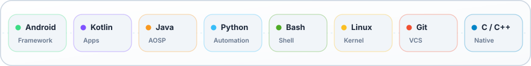

<!--
  Theme-aware GitHub Profile README – Solar System Edition.
  All visuals are vector SVGs delivering crisp resolution at any DPI with dark/light auto-switching.
  Central Star: @Dastgir-Siddiq · Planets: Core Projects & Architecture
-->

<!-- ─── Solar System Header Banner ─── -->
<picture>
  <source media="(prefers-color-scheme: dark)" srcset="./assets/header-dark.svg">
  <source media="(prefers-color-scheme: light)" srcset="./assets/header-light.svg">
  
</picture>

<!-- ─── Featured Planetary Projects Section Header ─── -->
<picture>
  <source media="(prefers-color-scheme: dark)" srcset="./assets/section-projects-dark.svg">
  <source media="(prefers-color-scheme: light)" srcset="./assets/section-projects-light.svg">
  
</picture>

<!-- ─── Responsive 2x2 Project Cards Grid ─── -->

  <a href="https://github.com/Dastgir-Siddiq/PersonalCloud">
    <picture>
      <source media="(prefers-color-scheme: dark)" srcset="./assets/card-personalcloud-dark.svg">
      <source media="(prefers-color-scheme: light)" srcset="./assets/card-personalcloud-light.svg">
      
    </picture>
  </a>
  <a href="https://github.com/Dastgir-Siddiq/Samsung-Galaxy-Tab-A7-WiFi-gta4lwifi-orangefox-recovery">
    <picture>
      <source media="(prefers-color-scheme: dark)" srcset="./assets/card-orangefox-dark.svg">
      <source media="(prefers-color-scheme: light)" srcset="./assets/card-orangefox-light.svg">
      
    </picture>
  </a>
   
  <a href="https://github.com/Dastgir-Siddiq/MediaOrganizer">
    <picture>
      <source media="(prefers-color-scheme: dark)" srcset="./assets/card-mediaorganizer-dark.svg">
      <source media="(prefers-color-scheme: light)" srcset="./assets/card-mediaorganizer-light.svg">
      
    </picture>
  </a>
  <a href="https://github.com/Dastgir-Siddiq/Realme_12_pro_plus_OrangeFox_Custom_Recovery">
    <picture>
      <source media="(prefers-color-scheme: dark)" srcset="./assets/card-modding-dark.svg">
      <source media="(prefers-color-scheme: light)" srcset="./assets/card-modding-light.svg">
      
    </picture>
  </a>

<!-- ─── Tech Stack Section Header ─── -->
<picture>
  <source media="(prefers-color-scheme: dark)" srcset="./assets/section-stack-dark.svg">
  <source media="(prefers-color-scheme: light)" srcset="./assets/section-stack-light.svg">
  
</picture>

<!-- ─── Tech Stack Orbital Deck ─── -->
<picture>
  <source media="(prefers-color-scheme: dark)" srcset="./assets/tech-stack-dark.svg">
  <source media="(prefers-color-scheme: light)" srcset="./assets/tech-stack-light.svg">
  
</picture>

<!-- ─── Animated Cosmic Heartbeat Footer ─── -->
<picture>
  <source media="(prefers-color-scheme: dark)" srcset="./assets/footer-dark.svg">
  <source media="(prefers-color-scheme: light)" srcset="./assets/footer-light.svg">
  
</picture>

